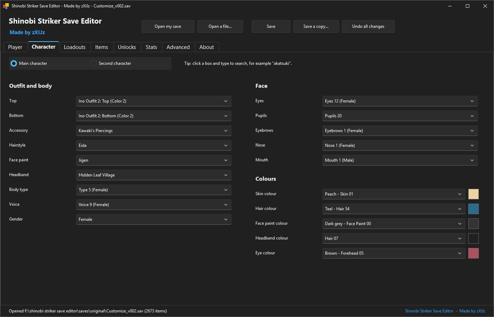
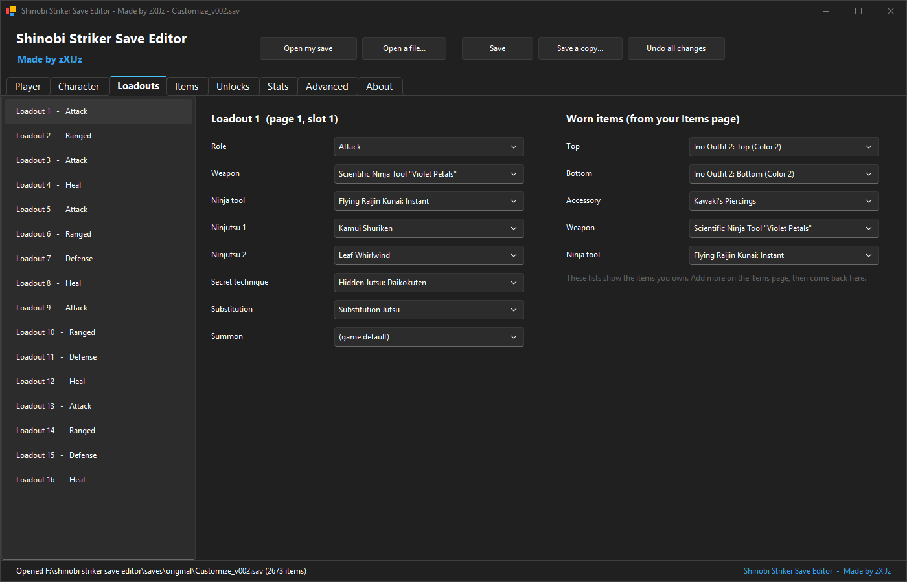
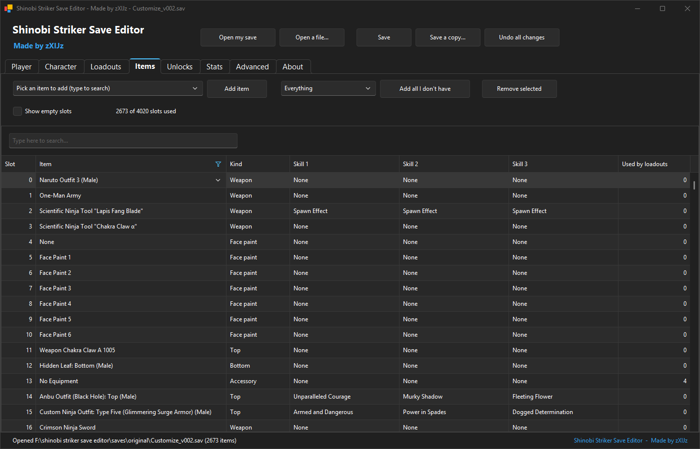
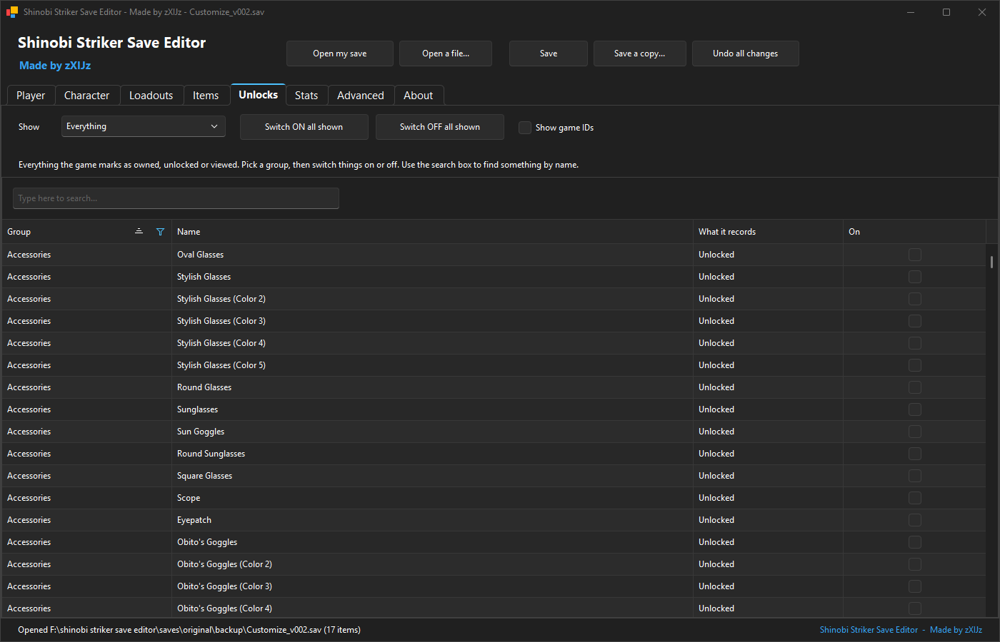

# Shinobi Striker Save Editor

**Made by zXIJz**

A free, easy save editor for **decrypted PS4 saves** of
NARUTO TO BORUTO: SHINOBI STRIKER.

It shows everything by its real in-game name (Kamui Shuriken, Hidden Cloud: Top, Gaara) and
never asks you to type a game code.

> **This editor is free.** If you paid for it, or paid someone for an edited save, you were
> ripped off. That is the reason it exists.



## Warning

Shinobi Striker is an online game. Using an edited save is against the publisher's rules and
**can get your account banned**. You use this at your own risk.

The editor only changes your own save file. It does not touch DLC ownership, the game's
files or the anti-cheat. It does not decrypt or encrypt saves either: use your own PS4 save
tools for that.

The game's servers may overrule some values. Keep the backup the editor makes for you.

### PC (Steam)

The PC save uses the same format and the editor opens it, but in my tests the PC game kept the
character on its servers and ignored the local file, so changes did not show in game. If you
find a way to make it work, the source is here: go for it.

## Use it in your browser (no download)

Open the **web editor** on this repository's GitHub Pages site: `https://<owner>.github.io/<repo>/`
(the link is in the repository's About box). It does everything the exe does and works on any
computer with a modern browser.

It runs entirely on your own PC: your save is **never uploaded**. **Save (download)** gives
you the edited file with the same name; your original file is not changed, so it is your
backup.

## Download

Get `ShinobiStrikerSaveEditor.exe` from the [Releases](../../releases) page. It is one file.
Nothing to install, Windows 10 or 11, 64-bit.

## How to use it

1. Export your Shinobi Striker save from the PS4 and **decrypt it** with your save tool.
2. Run `ShinobiStrikerSaveEditor.exe`, click **Open a file...** and pick
   `Customize_v002.sav`.
3. Change what you want (see the pages below).
4. Click **Save**. Your old save is kept next to the new one as
   `Customize_v002.sav.<date-time>.bak`.
5. **Re-encrypt** the save with your save tool and import it back to the PS4.
6. Start the game.

To search a list, click it and start typing. For example, type `akatsuki` in the Top box.

The player name can be at most 15 characters with no spaces (the editor enforces this).

### If something goes wrong

Delete the edited `Customize_v002.sav`, rename the newest `.bak` file back to
`Customize_v002.sav`, and import that.

| File | What it is |
|---|---|
| `Customize_v002.sav` | Your character: profile, looks, loadouts, items, unlocks, stats |
| `System_v002.sav` | Your game settings: screen and sound |

## The pages

| Page | What you can change |
|---|---|
| **Player** | Name, level, village, title, master, ninja rank, ranked grade, remake tickets, ryo, skill points, experience. A **Max** button sits next to each amount |
| **Character** | Both characters: top, bottom, accessory, hairstyle, face paint, headband, body type, voice, face parts and every colour (with a colour preview) |
| **Loadouts** | All 16 loadouts: role, weapon, ninja tool, both ninjutsu, secret technique, substitution, summon, and the items worn |
| **Items** | The item box (4,020 slots): add one item, add every item you do not have, remove items, change the three skills on each item |
| **Unlocks** | Everything the game marks as owned, unlocked or viewed. Pick a group such as Tops, Jutsu or Titles and switch it all on or off |
| **Stats** | Every number the game counts: master XP and ranks, wins, matches played, missions cleared |
| **Advanced** | Every field in the file as a tree, scrolls, ranked and event match data, and the activity log |
| **About** | Credits and links |







## Questions

**Windows says the file is unsafe.** The exe is not signed, so SmartScreen warns about it.
Click "More info", then "Run anyway". If you would rather not trust a download, build it
yourself from this source.

**My changes are gone after I start the game.** Check that you re-encrypted and imported the
edited save, and that the game was closed when you imported it. Online values may also be
overruled by the game's servers.

**An item shows as a tidy code instead of a name.** The game has no text for it (some colours
and unused entries). It still works.

**Does it work on Xbox or Switch saves?** Not tested. PS4 is the target.

**Will it decrypt my PS4 save?** No. Decrypt and re-encrypt it with your own save tools.

**Issues?** DM me. But it is open source for a reason, so download the source and patch or
fix stuff yourselves.

## Credits

| Who | For |
|---|---|
| **zXIJz** | Creating the editor and mapping the save format |
| [DevExpress WinForms](https://www.devexpress.com/products/net/controls/winforms/) | The user interface controls |
| [.NET 8](https://dotnet.microsoft.com/) | The runtime, including the zlib support used for the item box |
| [Unreal Engine 4](https://www.unrealengine.com/) | The save (GVAS) and pak formats the game uses. The [engine source](https://github.com/EpicGames/UnrealEngine) (needs an Epic-linked GitHub account) is the reference for both |
| Soleil and Bandai Namco | The game. Item, jutsu and title names in the editor are the game's own English text |

This is a fan-made tool. It is not made, approved or supported by Bandai Namco, Soleil, or
anyone who owns NARUTO or BORUTO.

## For developers

```
dotnet build ShinobiSave.sln -c Release
dotnet publish src\ShinobiSave.Editor -c Release -r win-x64 -o publish
src\ShinobiSave.Tests\bin\Release\net8.0-windows\ShinobiSave.Tests.exe <folder with your saves>
```

You need the [.NET SDK](https://dotnet.microsoft.com/download) 8 or newer and DevExpress
WinForms 25.2 (`DevExpress.Win`). DevExpress is a paid product: you need your own licence and
package feed to build. The released exe already contains everything it needs. If you do not
have DevExpress, `ShinobiSave.Core` has no UI and can be put behind any other GUI.

The tests want a folder holding `Customize_v002.sav` and `System_v002.sav`, plus a `backup`
subfolder with a fresh, unplayed `Customize_v002.sav`. Saves are not in the repository.

| Project | Purpose |
|---|---|
| `ShinobiSave.Core` | Save reader and writer, item box codec, name table. No user interface |
| `ShinobiSave.Editor` | The editor |
| `ShinobiSave.Dump` | Console tool: dump a save as text, and rebuild `ids.txt`, `schema.txt` and `names.tsv` from your own copy of the game |
| `ShinobiSave.Tests` | Console test runner |
| `ShinobiSave.Web` | The browser version (Blazor WebAssembly, no DevExpress needed). Published to GitHub Pages by `.github/workflows/pages.yml` |

Every rule that decides the bytes written (field creation, item adding, equip counts, the
round-trip self-check) is in `ShinobiSave.Core` (`EditOps`, `FieldSlot`,
`ShinobiSaveFile.Export`), so the exe and the web page produce the same save. The only
difference: the browser's zlib packs the item box slightly differently. The unpacked content is
identical, and the game reads either.

To run the web editor locally: `dotnet run --project src\ShinobiSave.Web`. To publish it,
enable **Settings > Pages > Source: GitHub Actions** in the repository; every push to `main`
then updates the site.

The save format is written up in [docs/SAVE_FORMAT.md](docs/SAVE_FORMAT.md): plain Unreal
Engine 4.16 GVAS with no encryption or checksum, and the item box stored as zlib blocks.

`names.tsv` (game ID to English name) is generated from the data tables of an installed copy
of the game with `ShinobiSave.Dump --pak-key`, `--pak-extract`, `--tables` and `--names`. The
pak key and the extracted game files are not in this repository and should not be added to it.
